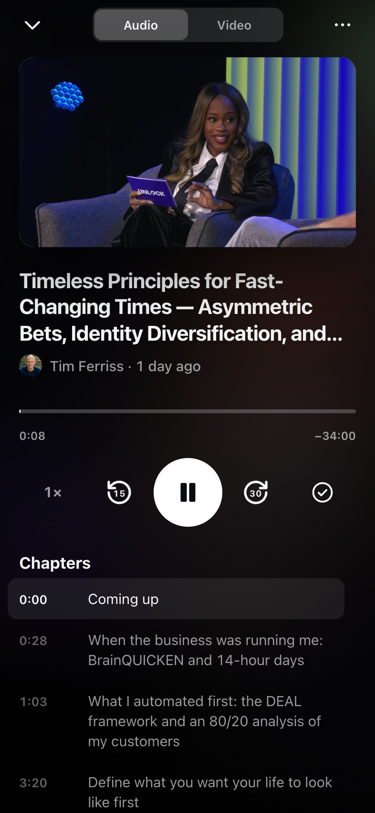
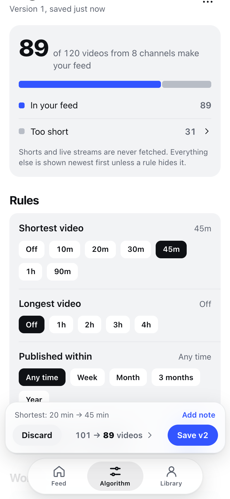
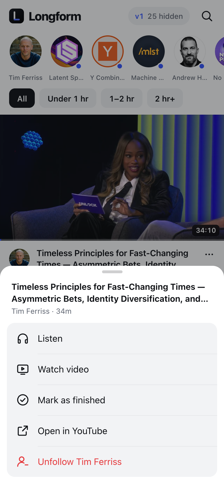

<div align="center">


# Longform

**Your YouTube, long-form only.**

No Shorts. No clickbait thumbnails. No infinite scroll.<br>
Just the channels you choose, filtered by rules you can read.

[Features](#features) · [The algorithm](#the-algorithm) · [Install](#put-it-on-your-iphone) · [How it works](#how-it-works)

<br>

&nbsp;
&nbsp;
&nbsp;


</div>

<br>

Longform is an open-source feed with the polish of a modern media app and none of the slot machine. Your algorithm is a handful of rules you can change, preview, and roll back. Podcasts keep playing with your phone locked. No account; everything lives on your device.

Inspired by Andrej Karpathy's [HackerTube](https://hackertube.org).

## Features

- **Long-form only** — Pick topics on first launch, follow channels by name, @handle, or link, or import your subscriptions. Shorts and live streams are never fetched.
- **A feed you can finish** — A frame from the middle of each video instead of the thumbnail, chips for how much time you have, and an end: *You're all caught up.*
- **Rules, not ranking** — Every video is shown, newest first, unless a rule hides it. No engagement signals, no ML. The whole algorithm is [`filter.ts`](src/lib/filter.ts).
- **Every change on record** — See which videos a change adds or removes before you save. Each save is a version you can restore in one tap.
- **Nothing hidden** — Every filtered video shows its reason, like `Shorter than 20 min (8:14)`. Tap it to play anyway.
- **Listen or Watch** — Audio-only playback survives a locked screen, with lock-screen controls. Switch to video at any second.
- **Made for long episodes** — Resume where you left off, chapters, 1–2× speed, −15 / +30 s skips, and a weekly listening summary.
- **Daily News Brief (zero cost)** — A calm **News** tab alongside your videos using public Bluesky feeds, RSS/Atom feeds, and Hacker News (no API keys). Multi-source stories cluster automatically into **Key Events**, standalone essays surface as **Key Insights**, and every hidden post has an explainable rule.
- **Private by design** — No account, no tracking. Export a backup file to move devices.

## The algorithm

```
Hide videos shorter than [20] min        (unknown length counts as short)
Hide videos longer than  [off] min
Hide videos older than   [off] days
Hide titles containing   [#shorts] [clip] [clips] [highlights] [reaction] [prank] …
…unless the title also contains [ ]
Hide videos I’ve finished [on]
```

Words match whole words, ignoring case and accents: `clip` hides “Best clip” but not “eclipse”. End a word with `*` to match its start: `react*` hides “reaction”. Rules are plain JSON, so you can also edit them as text.

<div align="center">
<br>
&nbsp;
&nbsp;
&nbsp;

<br><br>
</div>

## Put it on your iPhone

Longform is a web app you add to your home screen. It runs on a small server, which is your Mac to start with.

```sh
brew install node yt-dlp
npm install
npm start          # → Longform server on http://localhost:8787
```

1. Find your Mac's address in **System Settings → Wi-Fi → Details** (for example `192.168.1.20`).
2. On your iPhone, on the same Wi-Fi, open `http://192.168.1.20:8787` in Safari.
3. Tap **Share → Add to Home Screen**.

**Away from home:** install [Tailscale](https://tailscale.com) on both devices and open `http://<your-mac>:8787` from anywhere. `tailscale serve 8787` adds HTTPS, which also lets the app work offline.

> **Why not the cloud?** YouTube often blocks audio requests from data-center IPs. The feed works on any host; only Listen mode needs a home connection.

<details>
<summary><b>Development and Docker</b></summary>

<br>

```sh
npm run dev        # app on :5173 with hot reload, API on :8787
npm test           # filter and chapter tests
npm start          # production build on :8787 (PORT to change)
```

```sh
docker build -t longform .
docker run -p 8787:8787 longform
```

</details>

## How it works

```
Browser  ·  all your data, the filter         Server  ·  stateless, cached
─────────────────────────────────────         ──────────────────────────────────────────
channels, rules, history, progress     ──►    GET /api/channel/:id
applyRules(videos, rules) → feed              └ RSS of the long-form playlist + lengths
<audio src="/api/audio/:id">           ──►    GET /api/audio/:id
                                              └ yt-dlp finds the audio; the server relays it
YouTube IFrame player (Watch)                 GET /api/channels/find?q=
                   GET /api/avatar/:id
```

- **No API key.** Feeds come from YouTube's public RSS; lengths from one request per channel. Responses are the same for everyone, so a CDN can cache them.
- **Audio.** The server waits until a fresh stream URL is ready, then relays it in 8 MB chunks with Range support so Safari can seek. The feed warms the two likeliest next plays, so play is instant.
- **Small on purpose.** React + Vite with no router, state library, or UI kit: about 2,800 lines of TypeScript and one stylesheet. The server is [Hono](https://hono.dev), under 500 lines.

## Roadmap

- Sync between devices without an account
- Shared rule sets you can publish and subscribe to
- Per-channel rules and an Up Next queue
- Show notes with links in the player

## Contributing

Pull requests are welcome, especially **starter packs** ([`starter.ts`](src/lib/starter.ts)) and **filter behavior** ([`filter.ts`](src/lib/filter.ts) with [its tests](test/filter.test.ts)). The filter must stay deterministic and explainable: every hidden video needs a one-line reason.

<br>

<div align="center">
<sub>Not affiliated with YouTube or Google. Watch mode uses the official embed; Listen mode streams audio through your own server for personal use.<br>Support the creators you love. · <a href="LICENSE">MIT License</a></sub>
</div>
