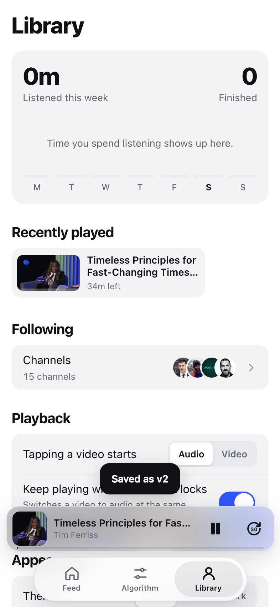

<div align="center">


# Longform

**A calm, non-brainrot, open-source YouTube replacement.**

No Shorts. No clickbait thumbnails. No infinite scroll. No ragebait slot machine.<br>
Your chosen channels plus an optional, AI-vetted daily Discover edition — with every rule transparent and under your control.

[Features](#features) · [The algorithm](#the-algorithm) · [Scaling & self-hosting](#put-it-on-your-phone-always-on--native-mobile-app) · [How it works](#how-it-works)

<br>

&nbsp;
&nbsp;
&nbsp;


</div>

<br>

Longform is an open-source, anti-addictive YouTube client you can self-host for yourself or run for thousands of users. It combines **deterministic, versioned feed rules**, a **server-cached canonical Gemini educational judge**, and **instant on-device taste personalization** from your 1–10 ratings — with zero engagement traps.

Inspired by Andrej Karpathy's [HackerTube](https://hackertube.org).

## Features

- **Long-form & concise explainers, zero Shorts** — Pulls each channel's `UULF` long-form playlist (never Shorts or livestreams). The default 3-minute floor drops micro-clips while keeping dense 4–19 min educational explainers.
- **A genuinely finite feed** — Mid-video frames instead of clickbait thumbnails, a 30-day default freshness window, a per-channel cap (default 2 per channel), an optional daily listening budget, and a clear end: *You're all caught up.*
- **Two-stage transparent algorithm** —
  1. **Fast deterministic filter ($0)**: blocked channels, finished videos, duration, age, per-channel cap, and high-precision slop phrases (tuned not to kill titles like *"Nuclear chain reaction"* or *"James Webb highlights"*).
  2. **Canonical Gemini educational judge + on-device personalization**: scores videos once on the server across depth, clickbait, ragebait, format, and overall educational value (1–10) using server-verified metadata and prompt-injection defenses. Discover **fails closed** until scored so unvetted brainrot never flashes into your feed.
- **1–10 ratings that actually personalize (at $0 LLM cost)** — Rate any video 1–10; Bayesian channel affinity, category affinity, and AI-bias calibration adjust scores instantaneously on-device without leaking your taste into other users' shared caches.
- **Calm Daily Discover Edition** — Optional unfollowed recommendations (Watch-Next graph by default, no login needed) refresh at most once per day (pull-to-refresh updates followed channels only), cap at 1 video per channel with topic spacing, rank by educational quality first, and blend gently (≤ 20% of the feed).
- **Every decision audited & versioned** — Preview exact before/after diffs before saving, inspect every hidden video or AI score (and play anything anyway), and roll back to any rule version in one tap.
- **Listen or Watch** — Background audio survives a locked screen with Media Session controls; switch to embedded video at any second.
- **Daily News Brief (zero cost)** — Calm **News** tab from Bluesky, RSS/Atom, and Hacker News with automatic multi-source event clustering.
- **Built for 1,000s of users (single always-on node)** — Persistent SQLite feed/catalog/judgment caches with stale-while-revalidate serving, incremental `channel_subscribers` indexing, automatic pruning, optional YouTube Data API batch duration lookups (50 videos per 1 quota unit), strict global YouTube concurrency gate + bounded queue + token bucket + 12s InnerTube timeouts + stale-on-error fallback, platform-gated per-user/IP rate limits (`TRUST_PROXY`), atomic global + per-user daily Gemini budgets (`GEMINI_DAILY_BUDGET`, `GEMINI_USER_DAILY_BUDGET`) with safety-block batch isolation, and tombstone-safe optimistic-concurrency sync with indexed `PATCH /api/me/progress`. *(Designed for one persistent Node/SQLite server on Fly.io, Railway, or a VPS; serverless hosts like Vercel use in-memory SQLite and are best for personal demos.)*

## The algorithm

```
Stage 1 · Deterministic rules (local, $0)
  Hide shorter than        [3 min]      (UULF long-form uploads never vanish if length lookup fails)
  Hide longer than         [off]
  Published within         [30 days]    (keeps the feed finite and finishable)
  Max per channel          [2 videos]   (prevents daily shows from flooding chronological order)
  Hide finished            [on]
  Hide titles with         [#shorts] [reaction video] [mukbang] [try not to laugh] [drama alert] …
  …unless they also have   [ ]

Stage 2 · Canonical AI Educational Judge + On-Device Taste (optional GEMINI_API_KEY)
  Scope                    [Discover only]  (followed channels untouched unless set to "All")
  Minimum effective score  [6/10]           (AI canonical score + on-device rating calibration)
  Always block brainrot    [on]
  Fail-closed Discover     [on]             (unscored recommendations wait quietly before appearing)

Stage 3 · Calm Blending
  Daily Discover Edition   [6 picks]        (max 1/channel, ranked by quality + diversity, ≤ 20% blend)
  Daily time budget        [off]            (optional soft pause reminder: 30m / 60m / 90m / 120m)
```

Whole-word, accent-insensitive matching: `clip` hides "Best clip" but not "eclipse"; trailing `*` matches word prefixes. All rules are plain JSON and versioned (`v1`, `v2`, …).

## Put it on your phone (always-on + native mobile app)

Longform runs both in the browser (PWA) and as a native **iOS / Android app** via Capacitor.

- **Zero-key self-host (works immediately):** Followed channels, deterministic filtering, clickbait guard, News brief, and Listen/Watch playback require **zero API keys**.
- **Full AI-vetted Discover:** Set `GEMINI_API_KEY` (defaults to `gemini-3.5-flash-lite` with `GEMINI_DAILY_BUDGET=10000` videos/day — roughly ~$0.25/day for ~1,000 users thanks to shared canonical caching; see [`.env.example`](.env.example) for sizing guidance and [`docs/EVAL_BASELINE.md`](docs/EVAL_BASELINE.md) for measured real-YouTube accuracy).
- **Scale to 100s–1,000s of users:** Add `YOUTUBE_API_KEY` (batches 50 video durations per 1 quota unit), `SESSION_SECRET`, Google OAuth (`GOOGLE_CLIENT_ID` / `GOOGLE_CLIENT_SECRET`), and `ALLOW_PUBLIC_SIGNUP=true`. See [`.env.example`](.env.example) and [`docs/DEPLOY.md`](docs/DEPLOY.md).
- **Local Mac dev / home Wi-Fi:**
  ```sh
  brew install node yt-dlp
  npm install
  npm start            # → Longform server on http://localhost:8787
  ```
- **Native iOS / Android app:**
  ```sh
  VITE_API_URL="https://your-longform-server.fly.dev" npm run build:mobile
  npm run cap:ios      # opens Xcode
  npm run cap:android  # opens Android Studio
  ```

<details>
<summary><b>Development, Tests & Docker</b></summary>

<br>

```sh
npm run dev        # app on :5173 with hot reload, API on :8787
npm test           # deterministic filter, real-YouTube benchmark (276 videos), judge, sync & security tests
npm run typecheck  # TypeScript strict check
npm start          # production build on :8787 (PORT to change)
```

```sh
docker build -t longform .
docker run -p 8787:8787 -v longform-data:/data longform
```

</details>

## How it works

```
Client (PWA / iOS / Android)                  Server (Hono + Node SQLite + Background Crawler)
──────────────────────────────────────────    ─────────────────────────────────────────────────────
local-first state, tombstones, ratings   ◄─►  GET/PUT /api/me/state (If-Match revision check)
lightweight playback ticks (every 30s)   ──►  PATCH /api/me/progress
batched channel refresh (≤50/req)        ──►  POST /api/channels/batch
                                                └ SQLite channel_feeds + ETag RSS + YT token bucket
daily Discover edition (1×/day)          ──►  POST /api/discover
                                                └ Watch-Next graph (or encrypted cookie on self-host)
deterministic filter + on-device taste   ──►  POST /api/judge (rate-limited, daily budget)
                                                └ canonical shared cache (server-verified catalog)
                                                └ isolated per-user cache for custom rubrics
<audio src="/api/audio/:id">             ──►  GET /api/audio/:id (yt-dlp audio relay with Range)
```

## Contributing

Pull requests are welcome — especially **starter packs** ([`starter.ts`](src/lib/starter.ts)), **filter & personalization improvements** ([`filter.ts`](src/lib/filter.ts), [`personalize.ts`](src/lib/personalize.ts)), and expanding the **real-YouTube benchmark dataset** ([`test/fixtures/real-youtube-benchmark.json`](test/fixtures/real-youtube-benchmark.json)).

<br>

<div align="center">
<sub>Not affiliated with YouTube or Google. Watch mode uses the official embed; Listen mode streams audio through your own server for personal use.<br>Support the creators you love. · <a href="LICENSE">MIT License</a></sub>
</div>
