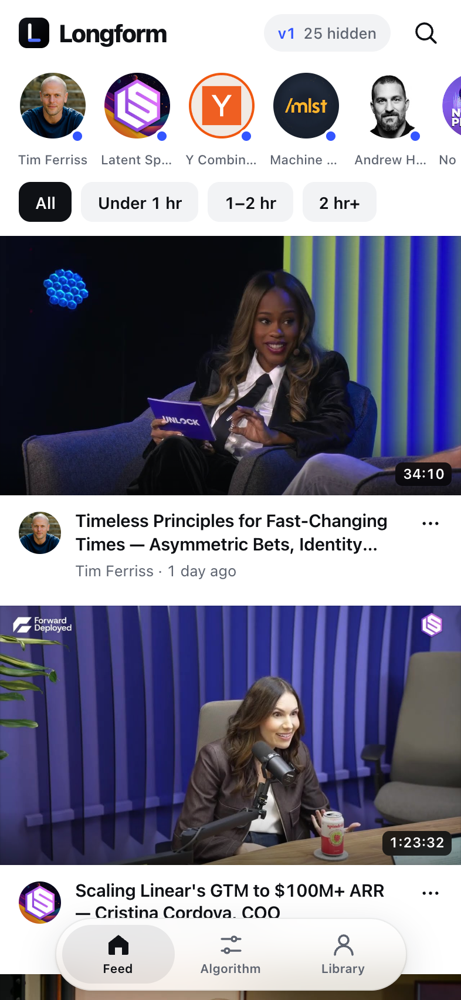
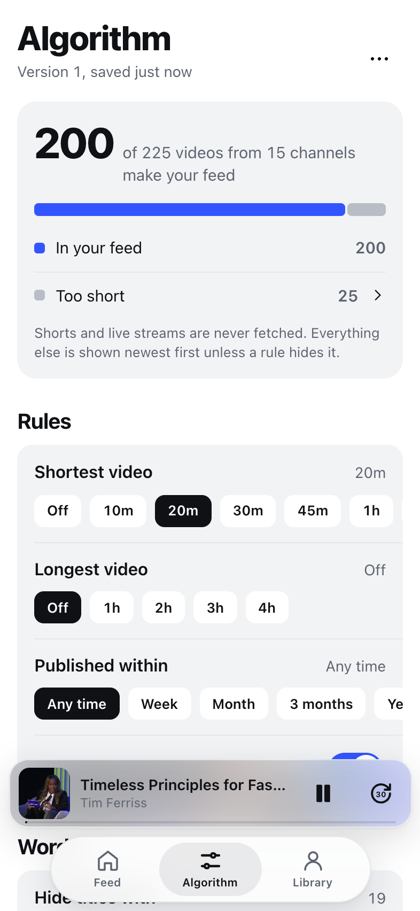
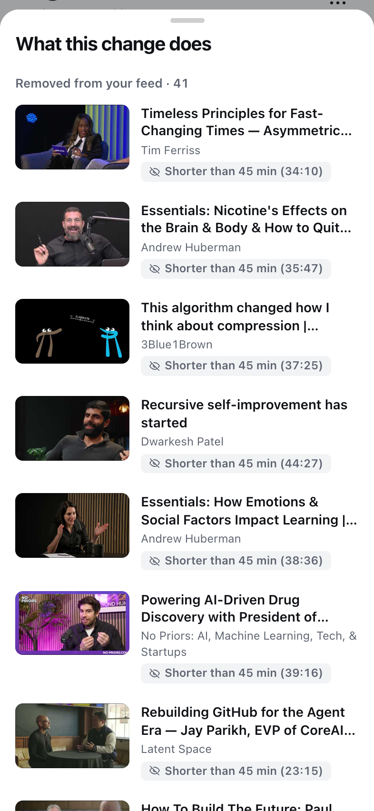
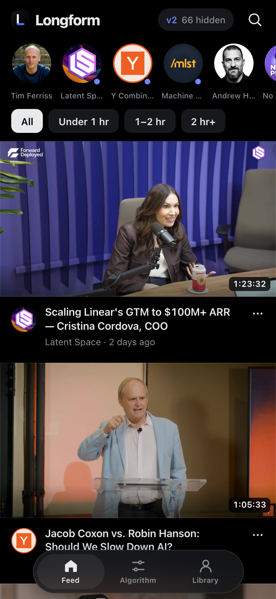

# Longform

**Your YouTube, long-form only.** An open-source feed of the channels you choose, with the polish of a modern media app and none of the slot machine: no Shorts, no clickbait thumbnails, no infinite scroll. Your algorithm is a handful of rules you can read, change, preview, and roll back. Podcasts keep playing when your phone is locked.

<p>
  
  
  
  
</p>

Inspired by Andrej Karpathy's [HackerTube](https://hackertube.org): account-free, local-first, and it shows a frame from the middle of each video instead of the uploader's attention-optimized thumbnail.

## What it does

- **Your channels, long-form only.** Pick what you want to learn on first launch (Podcasts, AI & Tech, Lectures & Science, Business), follow channels by name, @handle, or link, or import your YouTube subscriptions from Google Takeout. Shorts and live streams are never fetched.
- **A feed you can finish.** Full-width cards with mid-video frames, a row of your channels (a dot means a new episode), and chips for how much time you have: under 1 hour, 1–2 hours, 2 hours+. The feed ends with "You're all caught up", not more recommendations.
- **A deterministic filter.** Every video is shown, newest first, unless one of your rules hides it. No ranking, no engagement signals, no ML. The whole algorithm is [`src/lib/filter.ts`](src/lib/filter.ts).
- **Every change on the record.** The Algorithm tab shows how many of your videos make the feed and which rule hides the rest. As you change a rule, those numbers update live, and before saving you can see exactly which videos it adds or removes. Each save becomes a version (v1, v2, …) with an optional note, and any version can be restored in one tap.
- **Nothing hidden from you.** Every filtered video lists the exact reason (`Shorter than 20 min (8:14)`, `Title contains “clips”`). Tap one to play it anyway.
- **Listen or Watch.** Listen streams just the audio through a plain `<audio>` element, so it keeps playing with the screen locked and shows lock-screen controls. Watch uses the official YouTube embed. Switch at any second; if you lock your phone mid-video, it carries on as audio.
- **Made for long episodes.** Resume where you left off (the mini-player reopens with your last episode), chapters parsed from descriptions, speed control (1–2×), −15/+30s skips, Mark as finished, and a weekly listening summary.
- **Private by design.** No account. Your channels, rules, history, and progress live on your device. Export and import a backup file to move them.

## The algorithm

```
Shorts and live streams are never fetched.
Hide videos shorter than [20] min        (unknown length counts as short)
Hide videos longer than  [off] min
Hide videos older than   [off] days
Hide titles containing   [#shorts] [clip] [clips] [highlights] [reaction] [prank] [compilation] …
…unless the title also contains [ ]
Hide videos I’ve finished [on]
```

Words match whole words, ignoring case and accents: `clip` hides “Best clip” but not “eclipse”. End a word with `*` to match its start: `react*` hides “reaction”. Rules are plain JSON, so you can also edit them as text in the app.

<p>
  
  
  
  
</p>

## Put it on your iPhone

Longform is a web app you add to your home screen. It runs on a small server, which is your Mac to start with.

1. On your Mac, with [Node.js 20+](https://nodejs.org) and [yt-dlp](https://github.com/yt-dlp/yt-dlp#installation) installed (`brew install node yt-dlp`):
   ```sh
   npm install
   npm start
   ```
   It prints `Longform server on http://localhost:8787`.
2. Find your Mac's local address: **System Settings → Wi-Fi → Details → IP address** (for example `192.168.1.20`).
3. On your iPhone, on the same Wi-Fi, open **Safari** and go to `http://192.168.1.20:8787`.
4. Tap **Share → Add to Home Screen**. Longform now opens full-screen like an app.

**Away from home:** install [Tailscale](https://tailscale.com) on your Mac and iPhone (free for personal use) and open `http://<your-mac-name>:8787` from anywhere. Run `tailscale serve 8787` on the Mac to get an HTTPS address, which also lets the app work offline.

Why your own computer and not the cloud? YouTube often blocks audio requests from data-center IP addresses, while requests from a home connection work. The feed works on any host. Only Listen mode is sensitive to this.

## Run it anywhere else

```sh
npm install
npm run dev      # app on :5173 with hot reload, API on :8787
npm test         # filter and chapter tests
npm start        # production build, served on :8787 (PORT to change)
```

Docker (includes yt-dlp):

```sh
docker build -t longform .
docker run -p 8787:8787 longform
```

## How it works

```
Browser (all your data, the filter)          Server (stateless, cached)
───────────────────────────────────          ─────────────────────────────────────────────
channels, rules, history, progress   ──►     GET /api/channel/:id
applyRules(videos, rules) → feed             └ YouTube RSS of the channel's long-form playlist (UULF…)
                                               + lengths from the channel's Videos tab (youtubei.js)
<audio src="/api/audio/:id">         ──►     GET /api/audio/:id
                                             └ yt-dlp finds the AAC audio stream; the server relays it
                                               with HTTP Range support so Safari can seek
YouTube IFrame player (Watch)                GET /api/channels/find?q=  (name, @handle, or link)
                  GET /api/avatar/:id  (cached by the server, once a day)
```

- **No API key, no account.** Channel feeds come from YouTube's public RSS, which has exact publish dates and descriptions. Lengths come from one request per channel. Responses are identical for every user, so a CDN can cache them (`Cache-Control: s-maxage=900`).
- **Audio.** A fresh YouTube stream URL only works a few seconds after it is issued, and asking too early breaks it for good, so the server waits exactly as yt-dlp does. It relays bytes in 8 MB chunks because YouTube throttles larger ranges. The feed warms the two most likely next plays, so pressing play is instant.
- **The app** is React + Vite with no router or state library, about 2,800 lines of TypeScript plus one stylesheet, with no UI library. The server is [Hono](https://hono.dev) on Node, under 500 lines.

## Roadmap

- An X (Twitter) feed with the same deterministic filtering: long posts and threads, no engagement bait.
- Sync between devices without an account (an encrypted backup link).
- Shared rule sets: publish your rules and their history, and let others subscribe.
- Per-channel rules (for example, a lower minimum length for a lecture channel).
- An Up Next queue that plays episodes back to back.
- Show notes with links (papers, books) in the player.

## Contributing

Pull requests are welcome, especially:

- **Starter packs**: edit [`src/lib/starter.ts`](src/lib/starter.ts). Channels should mostly publish long-form work.
- **Filter behavior**: change [`src/lib/filter.ts`](src/lib/filter.ts) together with [`test/filter.test.ts`](test/filter.test.ts). The filter must stay deterministic and explainable: every hidden video needs a one-line reason.

## Note

Longform is not affiliated with YouTube or Google. Watch mode uses YouTube's official embedded player. Listen mode uses yt-dlp to stream audio through your own server, for personal use. Respect creators: watch on YouTube when you can, and support the channels you love.

MIT License.
